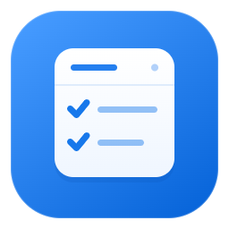

# Work Board



Локальное настольное приложение для контроля исполнения указаний и самостоятельных задач.
Electron + Node.js + Vue 3 + Vite + Pinia + Vue Router + Tailwind CSS + Lucide.
JavaScript, ESM, Composition API. Данные хранятся в выбранном пользователем файле SQLite.

[Репозиторий](https://github.com/greedval-us/work-board) · [Архитектура](docs/architecture.md) · [Разработка](CONTRIBUTING.md) · [Безопасность](SECURITY.md)

## Возможности

- Реестр с созданием, редактированием и удалением указаний: дата контроля,
  входящий номер, номер и название указания, содержание, конечный срок,
  исполнитель, статус и комментарий об исполнении. Таблица содержит восемь столбцов,
  сортировку и страницы по 25, 50 или 100 записей.
- Фильтры по номеру указания, включительному периоду сроков, исполнителю,
  статусу и тексту отметки. Поиск не зависит от регистра, включая кириллицу, и воспринимает `%` и `_`
  как обычные символы. Ввод применяется кнопкой «Применить»; есть «Сбросить».
- Месячный календарь с неделей с понедельника, переходами по месяцам и кнопкой
  «Сегодня». Счётчики контролей берутся из реестра. Самостоятельные задачи
  имеют дату, описание, срочность и признак выполнения и хранятся отдельно.
- Цветовые и текстовые метки просрочки, ближайших сроков и выполнения.
  Срочность обновляется при смене дня и возвращении в приложение.
- Выгрузка `.xlsx` через системный диалог. На листе «Указания» — все записи
  по последним применённым фильтрам и текущей сортировке, включая строки за пределами
  открытой страницы. Лист «Параметры» содержит условия, сортировку, время и число строк.
  Номера с начальными нулями и значения, похожие на формулы, сохраняются как текст.
- Светлая и тёмная темы, локальная работа без сетевого сервера.
- Адаптивное рабочее пространство: таблица и календарь занимают доступную высоту окна,
  фильтры раскрываются по кнопке, применённые условия видны в компактной строке.
  Все восемь столбцов помещаются по ширине; режим «Столбцы шире» включается отдельно.
  Пагинация и действия остаются на экране, длинные списки прокручиваются внутри своей области.
  При небольшом окне боковое меню сворачивается в иконки и раскрывается поверх содержимого.
- Плавные переходы между страницами, раскрытие меню и фильтров, появление и закрытие
  карточек и подтверждений. Повторное действие прерывает текущее движение;
  системный режим уменьшения движения отключает анимации.

В карточках есть явные «Сохранить» и «Отмена». Удаление требует подтверждения;
ошибка сохранения оставляет введённые данные в форме. Для несохранённых изменений
при закрытии карточки, переходе или закрытии приложения доступны сохранение,
отказ от изменений и продолжение редактирования.

## Запуск

Для разработки и CI используется Node.js **24** из `.nvmrc` и npm.
Минимальная версия в `package.json` — 22.13.

```sh
npm ci
npm run dev
```

`dev` запускает Vite на `127.0.0.1:5173`, сборку preload в watch-режиме
и Electron. Изменения Vue применяются через HMR. После изменения main или preload
перезапустите Electron; для main достаточно перезапустить `npm run dev`.

Запуск со встроенными собранными ресурсами, без Vite:

```sh
npm start
```

Чтобы открыть DevTools при разработке в PowerShell:

```powershell
$env:WORK_BOARD_DEVTOOLS = '1'
npm run dev
```

Не задавайте `ELECTRON_RUN_AS_NODE=1`: этот флаг запускает Electron как Node.js.

## Команды

| Команда | Назначение |
| --- | --- |
| `npm run dev` | Vite, watch preload, Electron |
| `npm start` | Сборка и запуск локального приложения |
| `npm run build` | Сборка renderer и preload в `build/` |
| `npm run icons` | Генерация PNG/ICO/ICNS из `src/public/icons/app.svg` |
| `npm run pack:win` | Распакованное приложение в `release/win-unpacked/` |
| `npm run build:win` | NSIS-установщик и portable EXE в `release/` |
| `npm test` | SQLite, выбор базы, реестр, календарь, XLSX, IPC, bridge и состояние renderer |
| `npm run check` | Тесты и сборка |
| `npm run test:desktop` | Сборка и запуск сценария реального Electron с изолированными данными |
| `npm run test:desktop -- --dev` | Та же проверка с временным Vite-сервером |
| `npm run test:package` | Проверка упакованного приложения после `build:win` |

При первой упаковке electron-builder может скачать дополнительные инструменты.
Исходная иконка — `src/public/icons/app.svg`, PNG для README — `app-256.png`
в той же папке. Генерация выполняется через `npm run icons`.
Шаг `afterPack` встраивает иконку и сведения о версии в EXE через `scripts/windowsResources.mjs`.
Подпись Windows не настроена.

## Структура

```text
src/
  main/
    index.js             # bootstrap и lifecycle
    createApplicationServices.js # сборка main-зависимостей
    app.js               # BrowserWindow и ограничения навигации
    preload.js           # вход ограниченного bridge
    database/            # SQLite, соединение и миграции
    ipc/                 # IPCManager и отдельные handlers
    repositories/        # запросы к локальным данным
    services/            # операции приложения
    utils/               # журнал
  renderer/
    components/          # реестр, календарь, настройки и общие UI-компоненты
    composables/         # поведение Vue
    infrastructure/      # безопасный IPC gateway, запросы, ошибки и motion
    layouts/app/         # оболочка с боковым меню
    router/              # hash-маршруты для file://
    services/            # адаптеры desktopAPI
    stores/              # данные реестра/календаря и общее состояние Pinia
    views/               # Registry, Calendar, Settings, Info
  shared/                # IPC channels, bridge, валидация и правила реестра/задач
  public/                # общие статические ресурсы
scripts/                 # иконки, desktop smoke и проверка пакета
tests/                   # проверки поведения
docs/architecture.md     # границы и правила расширения
```

## SQLite

Используется встроенный `node:sqlite`, без `sqlite3`, `better-sqlite3`,
`node-gyp` и пересборки нативных модулей. В Electron 38 он уже доступен.
Node.js может выводить штатный `ExperimentalWarning` для этого API.

При первом запуске без существующей базы приложение предлагает открыть настройки
и выбрать «Создать базу» или «Открыть базу». Расположение задаётся системным диалогом;
новый файл не создаётся поверх существующего. Выбранный путь отображается в настройках.
Переключение открывает другой набор данных, без автоматического переноса или объединения.

Путь последней базы хранится в `app.getPath('userData')/database-location.json`
(обычно `%APPDATA%/Work Board/database-location.json` в Windows).
Указания, задачи и тема находятся в самой SQLite. Если выбранный файл пропал,
приложение предлагает выбрать базу заново и не создаёт пустую замену молча.

При обновлении старой установки распознаётся прежняя база
`userData/data/work-board.sqlite`: она открывается на прежнем месте и получает
миграции с сохранением настроек. Чужая SQLite и база с более новой схемой
отклоняются до изменений. Отмена выбора или ошибка оставляет текущую базу активной.

Подключены WAL, foreign keys, busy timeout и транзакционные миграции.
Схема содержит `app_settings`, `instructions` и `calendar_tasks`.
Соседние файлы `-wal`/`-shm` относятся к рабочему соединению SQLite.
При разработке и обычном запуске используется одна папка userData;
проверки создают изолированные временные папки.

Во время операций записи и экспорта выбор другой базы блокируется.
Каждый запрос привязан к поколению соединения: старые карточки закрываются
после переключения, а запоздавшие ответы не подменяют данные новой базы.

Компоненты не обращаются к SQLite напрямую. Путь вызова:

```text
Vue → Pinia store → renderer service → requestDesktop → desktopAPI
    → preload → IPC handler → main service/repository → SQLite
```

Pinia stores владеют данными, фильтрами и запросами и сохраняют состояние при переходах.
Composables управляют локальными карточками и жизненным циклом интерфейса.
Единый gateway декодирует безопасные IPC-ответы; публичные ошибки не содержат SQL,
внутренних путей и stack trace. Неожиданные ошибки показываются общим уведомлением,
а сбой рендера раздела допускает повторное открытие.

В приложении нет HTTP/gRPC-сервера, API-ключей, сертификатов и сетевой базы.
Локальный Vite-сервер нужен только для разработки; собранное приложение работает без него.

## Проверка

`npm test` запускает тесты из `tests/main`, `tests/shared` и `tests/renderer`.
Они проверяют CRUD и сохранность SQLite, миграции, фильтры, сортировку и страницы,
агрегации календаря, создание и открытие баз, отмену и ошибки переключения,
содержимое XLSX, поколения запросов и сохранность формы при отказе записи.
Тесты состояния проверяют сохранение Pinia между маршрутами, single-flight и запоздавшие ответы;
тесты инфраструктуры — безопасные IPC envelopes и общую обработку ошибок.

`npm run test:desktop` запускает `scripts/registrySmoke.mjs` через настоящий bootstrap,
preload и Vue. Сценарий охватывает первый запуск, выбор баз, формы CRUD, фильтры,
экспорт нескольких страниц, календарь и задачи, защиту несохранённых изменений,
темы и компактное окно. Системные диалоги в сценарии получают заранее заданные ответы;
данные изолированы, скриншоты записываются в `output/`.
Геометрия реестра и календаря проверяется при размерах окна 1200×780, 1024×768,
720×640, 720×540 и 1440×900, включая месяц с шестью неделями, фокус меню
и закрытие фильтров клавишей Escape без потери черновика.
Сценарий также проверяет промежуточные кадры переходов, быстрое переключение страниц
и `prefers-reduced-motion`. Тестовое окно прозрачно, исключено из панели задач
и не перехватывает мышь; это позволяет Chromium отрисовывать реальные анимации.

## GitHub

Workflow [Windows CI](.github/workflows/ci.yml) запускает `npm ci`, `npm run check`
и `npm run test:desktop` на push, pull request и вручную.
Скриншоты smoke доступны в artifacts запуска.
Workflow [Build Windows artifacts](.github/workflows/build-windows.yml) запускается вручную:
проверяет приложение, собирает Windows с `--publish never`, выполняет `npm run test:package`
и сохраняет EXE как artifacts. GitHub Release автоматически не создаётся.

Зависимости, локальные SQLite с WAL/SHM, выгрузки, резервные копии, секреты и результаты
сборки исключены через `.gitignore`. Перед отправкой изменений проверьте `git status`.
Open-source лицензия в репозиторий не добавлена.

## Дальнейшая разработка

Добавляйте функциональность по существующим слоям, а не в `App.vue` или bootstrap.
Для новой сущности создайте миграцию, main repository/service, IPC handler,
именованный метод bridge и renderer service/store/view.
Миграции дописываются последовательно в `src/main/database/migrations.js`.
Прямой SQL и произвольные IPC-каналы в renderer не передаются.

Настройки Windows-упаковки находятся в `electron-builder.config.cjs`.
